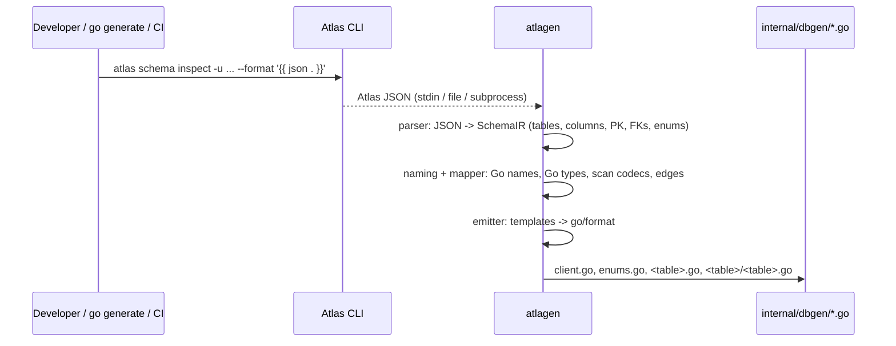
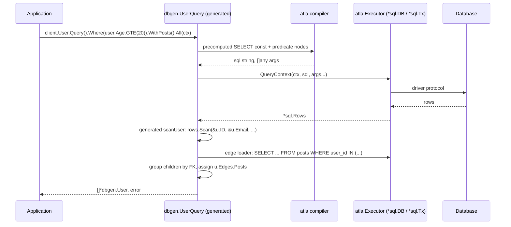

# System Architecture & Design Principles

This document defines the overall architecture of `atla-go`: the zero-dependency
runtime package `atla` and the Ahead-of-Time code generator `atlagen` (plus its
companion static analyzer `atlavet`).

`atla-go` is the Go sibling of [`atla`](https://github.com/hirokazumiyaji/atla)
(Python). It keeps the same design principles, but every public interface is
redesigned to be idiomatic Go: `context.Context` first, `error` return values,
generics instead of operator overloading, struct literals instead of keyword
arguments, and `database/sql` as the execution layer.

---

## 0. Why atla-go Exists

`atla-go` is intended as a replacement for [ent](https://entgo.io/) in projects
that already manage their schema with Atlas:

- ent's development pace has slowed, and it does **not** support composite
  (multi-column) primary keys in a usable way.
- ent's generated query API and its **edge-based eager loading** (`WithPosts()`)
  are worth keeping; `atla-go` reproduces the eager loading on top of foreign keys
  read from the Atlas schema, including composite foreign keys.
- ent owns the schema in Go code (`ent/schema/*.go`). `atla-go` does the opposite:
  the schema lives in Atlas, and Go code is generated from it.

### Goals

1. Atlas is the single source of truth. No Go-side schema DSL, no migrations.
2. Generated code performs no reflection on the hot path. Its performance should be
   close to a handwritten `rows.Scan` loop.
3. Type errors in queries are caught by `go build`. Missing required `INSERT`
   columns are caught by `atlavet` in CI.
4. Composite primary and foreign keys work everywhere a single-column key works:
   `Get`, `GetMany`, edges, and eager loading.
5. ent-style edge eager loading (`WithXxx()`), implemented with two queries
   (`WHERE fk IN (...)`) and no lazy loading.

### Non-goals

- Schema definition or migrations. Use Atlas for both.
- Lazy loading, change tracking, identity map, unit-of-work. Records are plain structs.
- ent features beyond edges: hooks on mutations, privacy policies, GraphQL/gRPC
  extensions, and schema mixins.
- Hiding SQL. The builder is a typed SQL builder, not an object store.

### Anti-goals (failure even if it "works")

- Reflection-based row mapping or `map[string]any` in the generated read path.
- A runtime dependency on a specific driver (`pgx`, `go-sql-driver/mysql`, …) in the
  `atla` package.
- Silent full-table `UPDATE` / `DELETE`.
- An API that forces `interface{}` / `any` on users for normal queries.

---

## 1. Four Core Design Pillars (shared with atla)

### 1.1 Single Source of Truth: Full Delegation to Atlas

`atlagen` consumes the JSON emitted by `atlas schema inspect --format '{{ json . }}'`.
The same JSON fixtures can be used by atla and atla-go.

### 1.2 Zero Runtime Overhead via AOT Code Generation

| atla (Python) | atla-go |
| :--- | :--- |
| `dependencies = []` | `atla` module `go.mod` has **no `require` lines**. Standard library only. |
| `Record(*row)` tuple unpacking into slots dataclasses | Generated `scanUser(rows)` calls `rows.Scan(&u.ID, &u.Email, …)` directly into struct fields. No reflection, no intermediate `map`. |
| `_SELECT_SQL` class constants | Generated Go `const` strings per table and dialect: `SELECT` list, `Get` by PK, `GetMany` prefix, `INSERT` column fragments. |
| `__slots__` everywhere | Small value-type builders and expression nodes. The compiler appends to one pre-sized `[]byte` buffer. |

### 1.3 Type Safety: Caught by the Go Compiler

- Python's `Column[T]` with operator overloading becomes Go generics:
  `atla.Column[T]` exposes methods (`EQ(v T)`, `GT(v T)`, `In(vs ...T)`, …), so
  `user.Age.EQ("20")` does not compile.
- `atla.Expr[T]` is a **sealed generic interface** that carries `T` in an unexported
  phantom method (`exprOf(T)`). Because of that method, `Expr[int64]` and
  `Expr[string]` are mutually non-assignable, so `post.UserID.EQExpr(user.Name)` is a
  compile error. This behaviour was checked with Go 1.24 while writing this design.
- Python's keyword-only `insert(email=..., name=...)` becomes a generated
  struct literal (`dbgen.UserInsert{...}`). Go cannot require struct fields at
  compile time, so the companion analyzer **`atlavet`** reports literals that omit
  required columns (see `generator-spec.md` §6).

### 1.4 Multi-RDBMS

| Engine | Phase | Recommended driver (user's choice, not a dependency) |
| :--- | :--- | :--- |
| PostgreSQL | first | `github.com/jackc/pgx/v5/stdlib` |
| SQLite (3.35+) | first | `modernc.org/sqlite` (pure Go) or `github.com/mattn/go-sqlite3` |
| MySQL | later | `github.com/go-sql-driver/mysql` |
| TiDB | later | `github.com/go-sql-driver/mysql` |
| CockroachDB | out of scope for now | The Postgres dialect is designed so that a Cockroach variant is a small subtype later. |

---

## 2. Key Go-Specific Design Decisions

| Area | atla (Python) | atla-go | Reason |
| :--- | :--- | :--- | :--- |
| Execution layer | `DBAdapter` protocol over asyncpg/asyncmy/aiosqlite | `atla.Executor`, a 2-method interface satisfied by `*sql.DB`, `*sql.Tx`, `*sql.Conn` | Works with any `database/sql` driver and existing tools (otelsql, sqlmock). Driver-specific fast paths (COPY) are optional capabilities. |
| Async | `async`/`await` | Blocking calls taking `ctx context.Context` as the first argument | Go convention. Cancellation and deadlines come from `ctx`. |
| Errors | Exception hierarchy | Sentinel errors (`atla.ErrNotFound`, …) plus `*atla.DBError` with `Unwrap() []error` | `errors.Is(err, atla.ErrUniqueViolation)` and `errors.As(err, &pgErr)` both work. |
| Operators | `User.age >= 20`, `&`, `\|`, `~` | `user.Age.GTE(20)`, `atla.And`, `atla.Or`, `atla.Not` | Go has no operator overloading. Methods also avoid the `__bool__` pitfall entirely. |
| Literal vs expression operands | One `T \| Expr[T]` parameter | Two methods: `EQ(v T)` and `EQExpr(e Expr[T])` | Go has no union parameter types or overloading. |
| Insert arguments | Required kw-only args + `= UNSET` | `UserInsert` struct: required columns are plain `T`; defaulted columns are `atla.Opt[T]`; nullable columns are `atla.Opt[*T]` | Readable and idiomatic. Missing required columns are reported by `atlavet`. |
| Update arguments | `.set(age=User.age + 1)` | `Update(dbgen.UserUpdate{Age: atla.SetExpr(user.Age.Add(1))})` | Same struct pattern as insert. Only columns of the target table can be assigned, and the value types are checked. Columns that the *expression* references are not checked against the table; SQL rejects foreign references at execution time. |
| Joined results | `tuple[UserRecord, PostRecord]` via `TypeVarTuple` | `atla.Pair[*User, *Post]` (2-way) and `atla.Triple` (3-way) | Go generics have no variadic type parameters. |
| Projections | `select(User.id, User.email) -> tuple[int, str]` | `atla.Select2(q, user.ID, user.Email)` … `Select8` returning `atla.Tuple2[int64, string]` … | Same reason. Generic *functions* are used because Go methods cannot declare type parameters. |
| Nullable columns | `Column[T \| None]` | `NullColumn[T]` (and `NullNumberColumn` / `NullStringColumn`). Comparisons take `T`; the expression type is `sql.Null[T]`. | Projections and `Coalesce` of nullable columns are type-safe and cannot fail on NULL. |
| Builder immutability | `__slots__` + tuple copies | Value-type builders. Every method returns a modified copy, and slices are cloned before append. | A base query stored in a variable can be branched safely. |
| Transactions | `async with db.transaction() as tx:` | `client.Tx(ctx, func(tx *dbgen.Client) error { … })` | Commit on `nil`, rollback on error or panic. Nested calls use `SAVEPOINT`. |
| Eager loading | `preload(...)` returns tuples | ent-style `WithPosts()`. Results go in `u.Edges.Posts`, and `u.Edges.PostsOrErr()` returns `atla.ErrNotLoaded` when the edge was not requested. | Familiar to ent users and keeps the result type `[]*User`. |
| Streaming | `async for` / `stream()` | `Iter(ctx) iter.Seq2[*User, error]` (range-over-func) | Go 1.23+ idiom. |

---

## 3. Repository Layout

The repository has two Go modules, mirroring atla's `packages/atla` and
`packages/atlagen` split. The runtime module has zero dependencies, so importing
`atla` adds nothing to an application's build. The tooling module may depend on
`golang.org/x/tools` and a YAML parser. Installing the generator with
`go get -tool` records those as tool dependencies in the application's `go.mod`, but
they are never linked into application binaries. Teams that want a completely clean
`go.mod` can run `go run github.com/hirokazumiyaji/atla-go/atlagen/cmd/atlagen@vX.Y.Z`
instead.

```text
atla-go/
├── go.mod                       # module github.com/hirokazumiyaji/atla-go  (runtime, no requires)
├── go.work                      # dev workspace: . ./atlagen ./internal/e2e (committed; see roadmap P0)
├── README.md
├── docs/
│   ├── architecture.md
│   ├── runtime-spec.md
│   ├── generator-spec.md
│   └── roadmap.md
│
├── atla.go                      # package atla: package doc, Executor, Client helpers
├── expr.go                      # Expr[T], node, And/Or/Not, Raw[T], Exists, subqueries
├── column.go                    # Column[T], NumberColumn[T], StringColumn, BoolColumn, Order
├── funcs.go                     # Count, Sum, Avg, Min, Max, Coalesce
├── opt.go                       # Opt[T], Some, SetExpr, Null
├── query.go                     # Select[R] core (where/order/limit/lock), terminal ops
├── mutation.go                  # Insert[R], Update[R], Delete[R] cores, unsafe-mutation guard
├── join.go                      # Join / LeftJoin / Pair / Triple
├── project.go                   # Select2..Select8, Tuple2..Tuple8
├── edge.go                      # eager-loading core (batched IN loaders, key grouping)
├── tx.go                        # Tx runner, savepoints, TxOption
├── errors.go                    # sentinels, DBError, error classification hooks
├── compiler.go                  # single-pass []byte SQL compiler
├── dialect/                     # package dialect
│   ├── dialect.go               # Dialect interface
│   ├── postgres.go
│   ├── sqlite.go
│   └── mysql.go, tidb.go        # (later phase)
├── internal/
│   └── e2e/                     # separate module: generated code + integration tests + compile-fail tests + benchmarks
│
└── atlagen/                     # module github.com/hirokazumiyaji/atla-go/atlagen
    ├── go.mod
    ├── cmd/
    │   ├── atlagen/main.go      # CLI: generate / check
    │   └── atlavet/main.go      # singlechecker for the atlavet analyzer
    ├── config/                  # atlagen.yaml + flag resolution
    ├── inspect/                 # load Atlas JSON (stdin / file / run atlas CLI)
    ├── ir/                      # SchemaIR, TableIR, ColumnIR, EdgeIR, …
    ├── parser/                  # Atlas JSON -> IR
    ├── naming/                  # Go identifiers, initialisms, singularization, edge names
    ├── mapper/                  # SQL type -> Go type per dialect, overrides, scan codecs
    ├── emitter/                 # text/template + go/format; templates via embed
    │   └── templates/*.tmpl
    └── atlavet/                 # golang.org/x/tools/go/analysis Analyzer
```

---

## 4. Data Flow

### 4.1 Code Generation (development time)



### 4.2 Query Execution (runtime)



---

## 5. Developer Experience (target)

```go
//go:generate go tool atlagen generate

client := dbgen.NewClient(db) // db is *sql.DB opened with pgx/stdlib

// SELECT with typed predicates and eager loading
users, err := client.User.Query().
    Where(user.Age.GTE(20), user.IsActive.EQ(true), user.DeletedAt.IsNull()).
    OrderBy(user.CreatedAt.Desc()).
    Limit(10).
    WithPosts(func(q dbgen.PostQuery) dbgen.PostQuery {
        return q.Where(post.Published.EQ(true))
    }).
    All(ctx)
for _, u := range users {
    fmt.Println(u.Name, len(u.Edges.Posts))
}

// AOT primary-key lookups, single and composite
u, err := client.User.Get(ctx, 42)                    // ErrNotFound when missing
m, err := client.Membership.Get(ctx, orgID, userID)   // composite PK
ms, err := client.Membership.GetMany(ctx, []dbgen.MembershipKey{{OrgID: 1, UserID: 2}})

// INSERT: required columns are plain fields; atlavet reports missing ones
created, err := client.User.Insert(dbgen.UserInsert{
    Email: "alice@example.com",
    Name:  "Alice",
    Age:   28,
    Bio:   atla.SomePtr("hello"), // nullable column: Opt[*string]
}).Save(ctx) // RETURNING * -> *dbgen.User

// UPDATE with an expression, inside a transaction
err = client.Tx(ctx, func(tx *dbgen.Client) error {
    _, err := tx.User.Update(dbgen.UserUpdate{
        Age: atla.SetExpr(user.Age.Add(1)),
    }).Where(user.ID.EQ(created.ID)).Exec(ctx)
    return err
})

// JOIN (2-way) and projection
rows, err := atla.Join(client.User.Query(), dbgen.PostTable, post.UserID.EQExpr(user.ID)).
    Where(post.Published.EQ(true)).
    All(ctx) // []atla.Pair[*dbgen.User, *dbgen.Post]

pairs, err := atla.Select2(client.User.Query(), user.ID, user.Email).All(ctx)
// []atla.Tuple2[int64, string]
```

---

## 6. Performance Targets & Quality Gates

1. **Hydration**: scanning 1,000 rows into `[]*dbgen.User` must stay within
   **+15% CPU** of a handwritten `rows.Scan` loop on the same driver. Beyond the
   per-row struct and whatever `database/sql` itself allocates, it should make at
   most a constant number of allocations per query.
2. **PK lookup**: `client.User.Get` must stay within **+5%** of a handwritten
   `QueryRowContext(...).Scan(...)`. No builder or compiler work runs on this path.
3. **Builder + compile**: a 3-predicate `Where` + `OrderBy` + `Limit` query should
   compile with a small, fixed number of allocations (target ≤ 5). This target will be
   validated in phase P5 and adjusted with evidence.
4. **vs ent**: benchmark against ent on the same driver for PK lookup, filtered
   page, O2M eager load, and bulk insert. The benchmark lives in its own module so
   ent never enters the main module graph.
5. **Static checks**: runtime, generator, and generated code must be clean under
   `go vet`, `staticcheck`, and `golangci-lint` with the repository config, and
   `atlavet` must pass over the e2e module.
6. **Zero dependencies**: the root `go.mod` must contain no `require` directives.
   CI enforces this.
