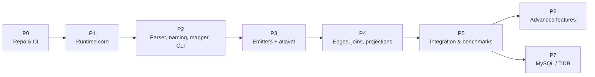

# Implementation Roadmap

Phased plan for `atla` (runtime) and `atlagen` / `atlavet` (tooling). PostgreSQL and
SQLite are first-class from Phase 1. MySQL and TiDB follow in Phase 7. Tracking issues
are not created yet. Each task below is sized to become one issue.

---

## P0: Repository & CI Foundation

- Root module `github.com/hirokazumiyaji/atla-go` (`go 1.24`, no `require`).
- Tooling module `atlagen/` and e2e module `internal/e2e/`.
- `go.work` for local development. **Commit it** and remove `go.work` / `go.work.sum`
  from `.gitignore`. In-repo cross-module development depends on it. CI also runs once
  with `GOWORK=off` so that each module is checked on its own.
- CI (GitHub Actions): `gofmt -l`, `go vet`, `staticcheck`, `golangci-lint`,
  `go test -race ./...` for every module, and the "root go.mod has no require" check.
  The Postgres service container for integration tests is part of P5, its first user.

## P1: Runtime Core (`atla`)

1. `Expr[T]` / sealed node interface, `Column`, `NumberColumn`, `StringColumn`
   and their `Null*` variants, `Order`, generic operator functions (`atla.GT`,
   `atla.Desc`, …), `And` / `Or` / `Not`, aggregates, `Raw`, subqueries, `Exists`.
   *Includes compile-fail tests (see Verification) for the type-safety claims.*
2. `dialect` package (`Postgres`, `SQLite`) and the single-pass compiler, with golden
   SQL tests per dialect.
3. `Executor`, `QueryInfo` in ctx, `TxExecutor`, `TxRunner`, `RunTx` (commit /
   rollback / panic / savepoints / options), `GenVersionN`, and the error sentinels, `DBError`, dialect `Classify`, and `RegisterClassifier`.
4. `Table[R]` + `RowScanner[R]` contract (needed by P4 joins, fixed now), `Select[R]` (`Where`, `OrderBy`, `Limit`, `Offset`, locks, `All`, `First`, `One`,
   `Count`, `Exist`, `Iter`, `ToSQL`), with an immutability test that branches a base
   query.
5. `Opt[T]` and the `Insert` / `Update` / `Delete` cores (`Exec`, `Save` with
   RETURNING, the unsafe-mutation guard, `ErrEmptyUpdate`).

## P2: Generator Front End (`atlagen`)

1. `inspect`: stdin, file, and `atlas schema inspect` subprocess.
2. `parser` → `ir`: tables, columns, PK (incl. composite), uniques, FKs (incl.
   composite), enums, and `HasDefault` detection. Reuse atla's
   `tests/fixtures/atlas/*.json`.
3. `naming`: initialisms, singularization, collisions, and overrides.
4. `mapper`: Postgres and SQLite tables, overrides, and scan plans.
5. `config` + `cmd/atlagen`: `generate`, `check`, `version`, YAML config, and
   import-path detection.

## P3: Emitters & Static Guarantees

1. Templates for `user/user.go`, `user.go`, `client.go`, `enum/enum.go`; `go/format`;
   determinism tests (generate twice, compare bytes).
2. Golden tests: fixture JSON → expected Go files (`-update` flag to refresh).
3. AOT shortcuts: `Get`, `GetMany` (single and composite, chunked), `DeleteByPK`.
4. `atlavet` analyzer + `cmd/atlavet`, tested with `analysistest`.
5. Compile-fail suite over generated code (see Verification).

## P4: Relations & Result Shapes

1. Edge derivation (M2O / O2M / O2O, naming, disambiguation, overrides).
2. `LoadEdge` runtime and generated `WithXxx` / `XxxOrErr` methods. Covers nested
   configurators, composite FKs, NULL FKs, empty parents, chunking, and `Iter`
   batching.
3. `Join` / `LeftJoin` / `Join3` / `LeftJoin3`, `Pair` / `Triple`, row scanners (`RowScanner`, nullable variant), and
   aliasing (`user.As`, `UserTable.Alias`).
4. `Select1..Select8`, `Tuple2..Tuple8`, `GroupBy` / `Having` / `Distinct`.

## P5: Integration Tests & Benchmarks

1. E2E against SQLite (`modernc.org/sqlite`, always on) and Postgres (`pgx/v5/stdlib`,
   CI service container, `ATLA_PG_DSN`).
2. Benchmarks (`go test -bench`, `-benchmem`) vs a handwritten `database/sql` scan loop
   and vs ent (separate benchmark module): PK lookup, filtered page, 1k-row hydration,
   O2M eager load, and insert. Check the targets in `architecture.md` §6 and record the
   results in the README.

## P6: Advanced Features (specified in `runtime-spec.md` §11)

Upsert, `InsertMany`, `pgxcopy` module, prepared queries, hooks, read-replica routing,
M2M edges, and the golangci-lint plugin for `atlavet`. Order is decided after P5,
based on what the first adopting service needs.

## P7: MySQL & TiDB

`dialect.MySQL` / `dialect.TiDB`, the mapper tables (§4.3 of `generator-spec.md`),
`Save` via `LastInsertId` + re-select, `ON DUPLICATE KEY UPDATE` upsert, the
classifier recipe for go-sql-driver, and a MySQL service container in CI.

---

## Verification Strategy

| Claim | How it is verified |
| :--- | :--- |
| Type mismatches do not compile | P1: the runtime compile-fail suite lives at the repo root (`compilefail_test.go` + `testdata/compilefail/`), covering the hand-written runtime API. P3: the generated-code suite in `internal/e2e/compilefail/`, where each case is a tiny `main` package that must **fail** `go build` with an expected error substring (driven by a Go test that runs `go build` per case). Cases: `user.Age.EQ("20")`, `post.AuthorID.EQExpr(user.Name)`, `UserUpdate{Age: atla.Some("x")}`, assigning `Expr[int64]` to `Pred`, `user.ID.EQExpr(post.EditorID)` (nullable vs non-null without `.NotNull()`), and setting a field that does not exist on `UserUpdate`. |
| Missing required insert fields are caught | `atlavet` `analysistest` cases plus running `go tool atlavet ./...` over the e2e module in CI. |
| Generated code is stable | `atlagen check` in CI against the committed e2e generated code. |
| Root module stays dependency-free | CI step: `go list -m all` in the root module prints only the module itself. |
| Performance targets | P5 benchmarks. Regressions are tracked manually at first; `benchstat` comparison in CI is optional later. |
